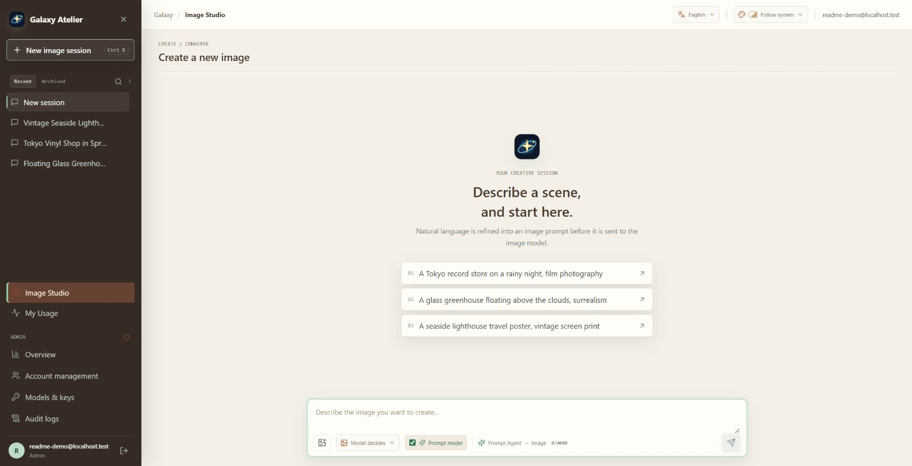
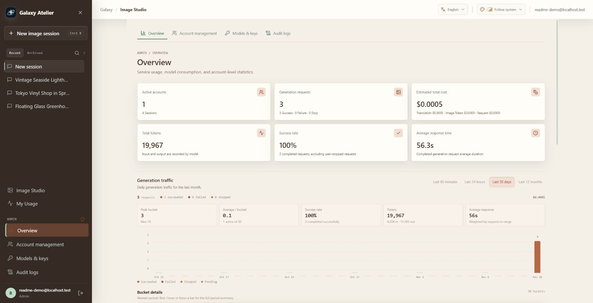
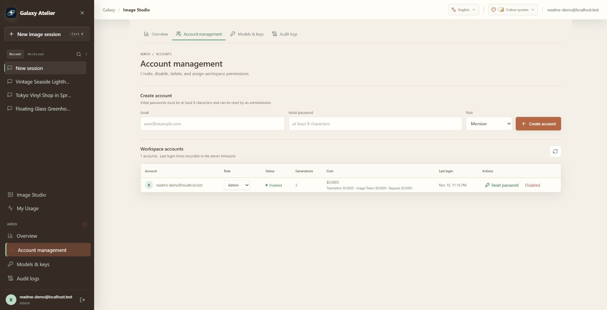
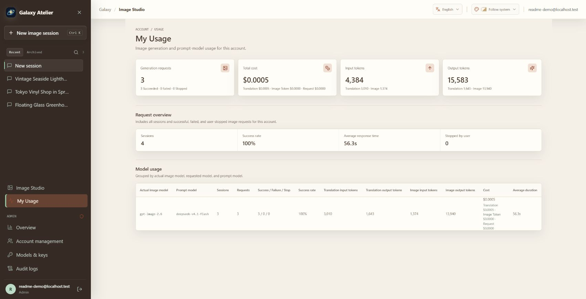
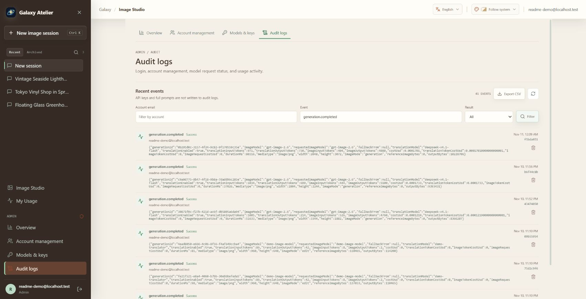
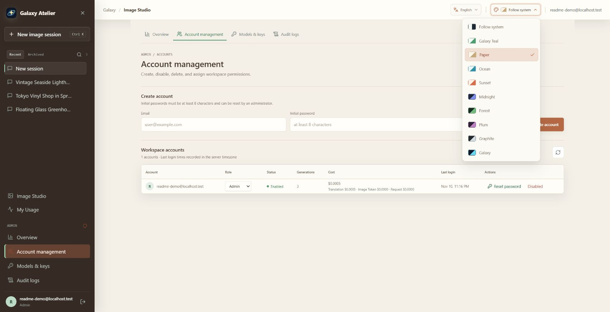
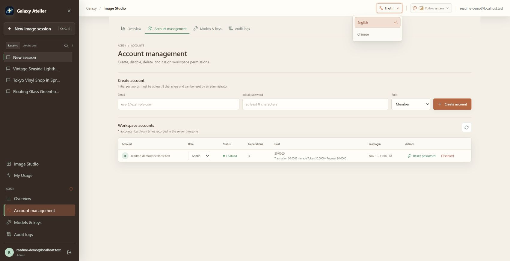

<div align="center">
  

  <h1>Galaxy Atelier</h1>
  <p><strong>A self-hosted image studio for turning natural-language conversations into images.</strong></p>
  <p>
    <a href="README.zh.md">简体中文</a> ·
    <a href="#workspace-overview">Overview</a> ·
    <a href="#screenshots">Screenshots</a> ·
    <a href="#getting-started">Getting started</a> ·
    <a href="#ubuntu-deployment">Ubuntu deployment</a>
  </p>
  <p>
    
    
    
    
  </p>
</div>

Galaxy Atelier is a self-hosted web workspace for running provider-backed image sessions and administering the service around them. Operators provision accounts and choose the prompt and image APIs; members work in account-scoped sessions with image context, request queues, and visible model feedback. Usage and operational records stay available to the people who run the workspace.

The application is deliberately limited to this workflow. Its prompt model does not receive tools for controlling the host computer.

**Category:** Self-hosted image-workspace and service administration<br>
**Best for:** Individuals and small teams who want to manage accounts, choose compatible model APIs, and review their workspace activity on infrastructure they operate.

## Contents

- [Workspace Overview](#workspace-overview)
- [Feature Guide](#feature-guide)
- [Image Workflow](#image-workflow)
- [Generated Examples](#generated-examples)
- [Architecture](#architecture)
- [Security and Data Boundaries](#security-and-data-boundaries)
- [Requirements](#requirements)
- [Getting Started](#getting-started)
- [Provider Configuration](#provider-configuration)
- [Ubuntu Deployment](#ubuntu-deployment)
- [Operations and Backups](#operations-and-backups)
- [Development and Tests](#development-and-tests)
- [Repository Layout](#repository-layout)
- [Limitations](#limitations)

## Workspace Overview

| Area | What it provides |
| --- | --- |
| **Workspace and accounts** | Administrator-provisioned accounts, account-scoped sessions and usage, searchable session history, archive/restore, and deletion controls. |
| **Provider administration** | Separate prompt and image API settings, editable base URLs and model IDs, model-list discovery, and configurable usage pricing. |
| **Operational visibility** | Member usage summaries, administrator traffic analytics across four time ranges, model/account breakdowns, and filterable CSV-exportable audit logs. |
| **Daily workflow** | A conversational image studio with optional prompt refinement, edit/reference modes, image uploads, model-selected sizing, and persistent per-session queues. |

The interface also supports English and Simplified Chinese, browser-language detection, nine named themes (four light and five dark), and a system-following appearance option.

For the complete capability register, code evidence, and the editorial decisions behind this README, see the [feature inventory](docs/FEATURE_INVENTORY.md).

<a id="screenshots"></a>
## Screenshots

These screenshots were captured from the running application using synthetic demonstration data. They show the workspace and its day-to-day administration rather than using generated art as the product's main presentation.

### Workspace and conversations

<p align="center"><a id="preview-studio" href="#image-workflow"></a></p>
<p align="center"><strong>Image Studio</strong><br>Create sessions, choose prompt-model and canvas options, and keep the conversation workflow in one workspace.</p>

### Administration and usage

<table>
  <tr>
    <td width="50%" valign="top">
      <a id="preview-overview" href="#workspace-operations"></a>
      <p align="center"><strong>Operations overview</strong><br>Traffic, success, usage, estimated cost, and period-by-period detail.</p>
    </td>
    <td width="50%" valign="top">
      <a id="preview-accounts" href="#workspace-operations"></a>
      <p align="center"><strong>Account management</strong><br>Create accounts, assign roles, reset passwords, and manage access.</p>
    </td>
  </tr>
  <tr>
    <td width="50%" valign="top">
      <a id="preview-usage" href="#workspace-operations"></a>
      <p align="center"><strong>Member usage</strong><br>Each account can inspect its own requests, model usage, and estimated cost.</p>
    </td>
    <td width="50%" valign="top">
      <a id="preview-audit" href="#workspace-operations"></a>
      <p align="center"><strong>Audit logs</strong><br>Filter operational events, inspect metadata, and export matching records as CSV.</p>
    </td>
  </tr>
</table>

### Interface preferences

<table>
  <tr>
    <td width="50%" valign="top">
      <a id="preview-themes" href="#interface-preferences"></a>
      <p align="center"><strong>Nine named themes</strong><br>Four light palettes, five dark palettes, and an option to follow the operating system.</p>
    </td>
    <td width="50%" valign="top">
      <a id="preview-language" href="#interface-preferences"></a>
      <p align="center"><strong>Two interface languages</strong><br>Choose English or Simplified Chinese, or let the browser language be detected automatically.</p>
    </td>
  </tr>
</table>

## Feature Guide

<a id="conversation-to-image"></a>
### Image Sessions and Requests

**Category:** Session-based creative workflow<br>
**Best for:** Keeping requests, outputs, model feedback, and follow-up edits organized by session.

**Overview:** Members describe an image in the studio and can optionally use the configured prompt model to refine the request. The conversation, generation status, returned feedback, and resulting image stay together in a session. The prompt model can be skipped for direct requests to the image API.

**Highlights:**

- Search, rename, archive, restore, or delete sessions. Conversation history can be paged without losing the current scroll position.
- Queue up to 12 requests in a session. Edit a queued prompt, remove it, or return it to the composer to adjust its options. The queue persists across service restarts.
- Expand the refined prompt and workflow summary to review model details and available provider feedback. Failed requests also retain available text feedback.
- On a new session's first request, the prompt model may suggest a session title and a descriptive image name.
- Review the resulting image, actual model and dimensions, available text feedback, and reported usage or estimated cost. Enlarge or download an image, or continue with it as an edit.

**Preview:** [Image Studio screenshot](#preview-studio)

<a id="image-guided-editing"></a>
### Image Context and Canvas Controls

**Category:** Image-guided generation and editing<br>
**Best for:** Making targeted changes to an existing image or using one as a visual reference.

**Overview:** Add an image and choose whether it is the edit target or a visual reference. These modes have different intent and are passed distinctly through prompt preparation and image-provider requests.

**Highlights:**

- Choose, drag, or paste an image. Browser-supported inputs are checked and normalized to PNG before submission.
- When prompt refinement is enabled, an attached image can be included as multimodal input to the prompt provider and forwarded to the image provider.
- A follow-up without a new image can reuse the latest successful prompt-refined turn's image as an edit target. When prompt refinement is skipped, attach the image explicitly.
- Choose model-decided, square, portrait, or landscape sizing when the request allows it. The application records the actual returned dimensions.

**Preview:** [Image Studio screenshot](#preview-studio)

<a id="workspace-operations"></a>
### Accounts, Providers, and Operations

**Category:** Self-hosted service administration<br>
**Best for:** Operators who want to manage accounts and model providers from the same application.

**Overview:** The administrator provisions accounts, configures prompt and image providers, and reviews service activity. Members see only their own sessions and usage. Public registration is not available.

**Highlights:**

- Configure separate provider base URLs, credentials, model IDs, and usage prices. Fetch model IDs from a provider and select a returned option.
- Edit the prompt model's system instructions; an empty custom value restores the bundled `AGENT.md` default.
- Manage account roles, access status, and password resets. Account sessions and usage are isolated.
- Review personal usage or administrator traffic by minute, hour, day, and month, with account and model breakdowns.
- Filter, export, and delete audit-log entries. Logs do not contain raw API keys or full prompts; provider-setting events may include configured base URLs.

**Previews:** [Operations overview](#preview-overview) · [Account management](#preview-accounts) · [Member usage](#preview-usage) · [Audit logs](#preview-audit)

<a id="interface-preferences"></a>
### Interface Preferences

Choose English or Simplified Chinese, with automatic browser-language detection by default. The interface offers nine named color themes and can follow the operating system's light/dark preference.

**Previews:** [Theme selector](#preview-themes) · [Language selector](#preview-language)

## Image Workflow

1. Sign in to an account provisioned by the administrator and open an image session.
2. Describe the scene. Optionally attach a reference image and select edit or reference mode.
3. Choose whether to use prompt refinement and select an aspect-ratio preset or model-selected sizing.
4. If enabled, the configured language model receives the current request, the most recent successful prompt-refined turn's user prompt and refined prompt when available, and any attached image as multimodal input. When no image is attached, a follow-up can reuse that turn's image as its edit target. If prompt refinement is disabled, attach an image explicitly to provide image context.
5. The server sends a generation or edit request to the configured image API. When prompt refinement is disabled, the user's text goes directly to the image API; an explicitly attached reference is still forwarded for the selected image workflow.
6. The result, actual image dimensions, provider/model metadata, usage when reported, and generation status appear in the session. Failed requests retain the model's available text response for inspection.

The prompt model is not a source of hidden tool access. The application does not give it a shell, filesystem, browser, plugin, or arbitrary URL-fetching tool.

## Generated Examples

The following examples were generated through a configured image API. They illustrate the output of the workflow; the screenshots above show the application itself. Gallery images are optimized JPEG previews, and captions show the original generated PNG dimensions.

<p align="center">
  <a id="preview-workbench" href="#image-workflow"></a>
</p>
<p align="center"><strong>Image Studio with a completed generation</strong><br>A screenshot captured from the running application.</p>

<table>
  <tr>
    <td width="50%" valign="top">
      <a id="preview-greenhouse" href="#image-workflow"></a>
      <p align="center"><strong>Skyborne Botanical Greenhouse</strong><br>3344 × 1882 · Generated image</p>
    </td>
    <td width="50%" valign="top">
      <a id="preview-tokyo" href="#image-workflow"></a>
      <p align="center"><strong>Rainy Night Tokyo Record Shop</strong><br>2804 × 2244 · Generated image</p>
    </td>
  </tr>
  <tr>
    <td colspan="2" align="center" valign="top">
      <a id="preview-lighthouse" href="#image-workflow"></a>
      <p align="center"><strong>Coastal Lighthouse Screen Print</strong><br>2048 × 3072 · Model-selected portrait canvas</p>
    </td>
  </tr>
</table>

## Architecture

```text
Browser
  └─ React + TypeScript client
       └─ same-origin /api requests
            └─ Node.js HTTP service
                 ├─ SQLite: accounts, sessions, messages, queue, usage, audit
                 ├─ DATA_DIR/images: generated and retained edit images
                 ├─ configured OpenAI-compatible chat-completions endpoint
                 └─ configured OpenAI-compatible image endpoint
```

The frontend is built with Vite. The backend uses Node.js's built-in HTTP and SQLite APIs; there is no separate database server or provider SDK to install. In production the Node service serves the built frontend and API from one origin.

## Security and Data Boundaries

- There is no public registration. The first administrator is created from server environment variables; administrators provision subsequent accounts.
- Passwords are scrypt-hashed. Session cookies are `HttpOnly` and `SameSite`; production cookies also use `Secure`.
- Login is temporarily rate-limited after repeated failed attempts for the same email and client IP.
- Provider credentials and administrator-overridden endpoints are encrypted at rest with AES-256-GCM using `APP_ENCRYPTION_KEY`. The key must remain stable for stored provider settings to remain decryptable. API responses do not return saved provider keys.
- Session, message, queue, image, and usage reads are scoped to the authenticated account. Administration routes require the administrator role.
- Uploaded reference images are signature-checked, bounded by size and dimensions, and sent only to the configured providers needed for the selected workflow. Queued references are encrypted in SQLite while waiting and removed when consumed or deleted; audit entries retain metadata rather than image bytes.
- Application files and the database are stored under `DATA_DIR`. The prompt model has no local machine-control capability.
- The included systemd service runs as a dedicated unprivileged user, restricts writable paths to the data directory, and enables operating-system hardening.

Self-hosting does not mean provider-free: when generation is requested, the prompt (and, where applicable, the reference image and conversation context) is transmitted to the provider endpoint configured by the administrator. Review that provider's data-handling terms and configure outbound network access accordingly.

## Requirements

- Node.js **24.9 or newer** (the project uses the built-in `node:sqlite` module).
- npm (bundled with Node.js).
- A compatible chat-completions API and image-generation API for real image creation.
- For Ubuntu service deployment: systemd **247 or newer** for every hardening directive used by the included unit.

## Getting Started

Clone the repository and install the locked dependencies:

```sh
git clone https://github.com/ABone16/galaxy-atelier.git
cd galaxy-atelier
npm ci
```

Create an environment file and generate a fresh encryption key:

```sh
cp .env.example .env
openssl rand -hex 32
```

Edit `.env`. Replace the example encryption key with the 64-character value you generated, set a unique initial administrator email and password, and set the provider base URLs if required. The example provider URLs are placeholders and are not working services.

Start the development client and API:

```sh
npm run dev
```

Open `http://127.0.0.1:5173`. Vite serves the client; the API listens on `127.0.0.1:4318` by default. Sign in with the initial administrator credentials and configure both providers under **Models & keys**. The providers can be OpenAI-compatible services; the base URL, API key, and model ID are set by the administrator, and available models can be fetched from the provider's `/models` endpoint.

To run the built service locally instead:

```sh
npm run build
npm start
```

Production mode serves the compiled client and API from the Node.js service. Set `NODE_ENV=production` and use a reverse proxy with TLS for remote access.

## Provider Configuration

Both providers use an OpenAI-compatible request shape:

| Purpose | Request |
| --- | --- |
| List models | `GET {BASE_URL}/models` |
| Refine a prompt | `POST {BASE_URL}/chat/completions` |
| Generate a new image | `POST {BASE_URL}/images/generations` |
| Edit with a reference image | `POST {BASE_URL}/images/edits` |

Configure the exact provider base URL, key, and model ID in the protected management page. Do not append the endpoint path (such as `/chat/completions`) to the base URL. The provider must support the request and response fields used by this application. Image generation currently expects a base64-encoded PNG in `data[0].b64_json`; arbitrary remote image URLs are not fetched. Model discovery shows IDs exposed by the provider; it does not guarantee every listed model implements the required image contract.

There is one explicit image-model compatibility fallback: if `gpt-image-2.6` returns HTTP 404 and is absent from the provider's model list, the server may retry with `gpt-image-2.5` or `gpt-image-2` when that ID is listed as available. The result and audit record report the model actually used. This is not a general provider switch or retry policy.

Environment defaults are documented in [.env.example](.env.example). Default service URLs are intentionally placeholders; endpoint overrides made by an administrator are encrypted together with provider credentials.

## Ubuntu Deployment

Build on the target Ubuntu server. Do not copy `node_modules` built on Windows or another operating system. The repository includes a hardened systemd template at [`deploy/atelier-agent.service`](deploy/atelier-agent.service) and a placeholder environment template at [`deploy/atelier-agent.env.example`](deploy/atelier-agent.env.example).

Install Node.js 24.9 or newer using your preferred trusted distribution, then prepare an application directory and system account:

```sh
sudo useradd --system --home /var/lib/atelier-agent --shell /usr/sbin/nologin atelier-agent
sudo install -d -o atelier-agent -g atelier-agent -m 700 /var/lib/atelier-agent
sudo install -d -m 700 /etc/atelier-agent
sudo install -d -o "$(id -un)" -g "$(id -gn)" -m 755 /opt/atelier-agent
```

Clone a clean source checkout into the empty application directory. The current user owns this directory so the dependency install and build do not need to run as root:

```sh
git clone https://github.com/ABone16/galaxy-atelier.git /opt/atelier-agent
cd /opt/atelier-agent
npm ci
npm run typecheck
npm test
npm run build
npm run test:production
```

Create `/etc/atelier-agent/atelier-agent.env` from `deploy/atelier-agent.env.example`. Set production values, a new key from `openssl rand -hex 32`, a unique initial administrator, and provider endpoint defaults. Keep the file root-readable:

```sh
sudo chown root:root /etc/atelier-agent/atelier-agent.env
sudo chmod 600 /etc/atelier-agent/atelier-agent.env
```

Install and validate the service unit:

```sh
sudo install -o root -g root -m 644 deploy/atelier-agent.service /etc/systemd/system/atelier-agent.service
sudo systemd-analyze verify /etc/systemd/system/atelier-agent.service
```

The unit assumes the service source and build are at `/opt/atelier-agent`, data at `/var/lib/atelier-agent`, and Node.js at `/usr/bin/node`. Adjust the unit if your paths differ. Then enable it:

```sh
sudo systemctl daemon-reload
sudo systemctl enable --now atelier-agent
sudo systemctl status atelier-agent
sudo journalctl -u atelier-agent -n 100 --no-pager
```

After confirming that the initial administrator can sign in, remove `INITIAL_ADMIN_EMAIL` and `INITIAL_ADMIN_PASSWORD` from the environment file and restart:

```sh
sudo systemctl restart atelier-agent
```

The application binds to loopback (`127.0.0.1:4318`) by default. Put it behind a reverse proxy that terminates TLS; do not expose the application port directly to the public internet. The systemd unit requires systemd 247+ because it uses `ProtectProc` and `ProcSubset`.

## Operations and Backups

- Keep `APP_ENCRYPTION_KEY` stable and store a protected backup separately from the database. Without it, saved provider credentials and endpoint overrides cannot be decrypted.
- Back up the complete contents of `DATA_DIR`, including `atelier.sqlite`, SQLite's WAL files when present, and the `images/` directory. For a consistent online backup use SQLite's backup API or stop the service before copying files.
- Restrict the environment file, data directory, and backups to the service administrator. Never publish `.env`, database files, logs, or private images.
- Configure TLS and suitable proxy request/body/time limits for image-reference uploads. The application accepts a reference image up to 10 MiB and a larger generation request body to accommodate its encoding.
- Use `systemctl status` and `journalctl -u atelier-agent` for service health and diagnostics. `/api/health` is a process health check, not a provider-connectivity test.

## Development and Tests

```sh
npm run typecheck
npm test
npm run build
npm run test:production
```

`npm test` runs the Node.js test suite. The production smoke test starts a temporary production service with an isolated data directory and mocked provider requests; it exercises bootstrap, login, configuration, generation, image retrieval, usage, audit, and logout without contacting a real model provider. Run the typecheck, test suite, build, and smoke test before releasing changes.

## Repository Layout

```text
src/                         React client, API types, localization, and UI styles
server/index.ts              HTTP API, SQLite schema, auth, generation, and provider calls
tests/                       Unit and security/integration test suites
scripts/                     Production smoke test and isolated provider mock
deploy/                      systemd and environment-file templates
docs/assets/                 README artwork, generated examples, and UI screenshot
AGENT.md                     Prompt-writing role and tool boundary for the host
.env.example                 Local and production environment variable template
```

For the full feature register and README editorial rationale, see [`docs/FEATURE_INVENTORY.md`](docs/FEATURE_INVENTORY.md).

## Limitations

- Galaxy Atelier does not include an image model, translation model, or API credits. Configure compatible provider services to generate real images.
- Provider-compatible does not mean universally interchangeable: endpoint paths, authentication, image-edit support, output formats, and usage reporting vary. Confirm the contract with your provider.
- The current deployment template targets a single Node.js process with a local SQLite database and filesystem image storage. It is not a horizontally scaled or object-storage deployment.
- Usage cost figures are estimates based on configured prices and provider-reported usage; a provider may omit token or cost data.
- Provider terms, rate limits, model IDs, and Linux package availability are controlled by their respective maintainers and can change independently of this project.
