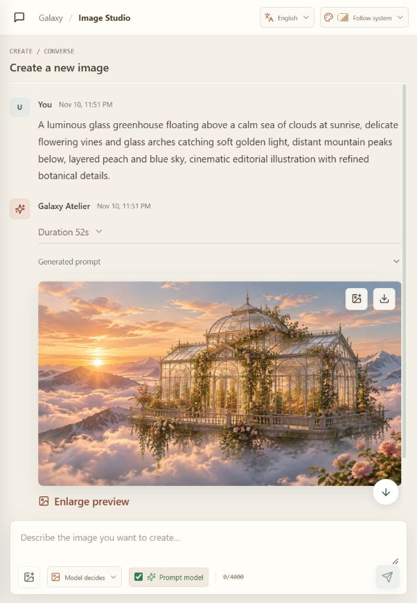

<div align="center">
  

  <h1>Galaxy Atelier</h1>
  <p><strong>A self-hosted image studio for turning natural-language conversations into images.</strong></p>
  <p>
    <a href="README.zh.md">简体中文</a> ·
    <a href="#product-highlights">Overview</a> ·
    <a href="#showcase">Showcase</a> ·
    <a href="#getting-started">Getting started</a> ·
    <a href="#ubuntu-deployment">Ubuntu deployment</a>
  </p>
  <p>
    
    
    
    
  </p>
</div>

Galaxy Atelier is a small, self-hosted web workspace for image creation. Describe a scene in a conversational composer, optionally refine the prompt with a language model, and send the resulting request to an image API that you configure. Sessions, generated images, usage records, and administration live on your own server.

It is designed around one deliberately narrow job: turn a user's creative request into an image. It is not a general-purpose computer agent.

**Category:** Self-hosted, conversational image-generation workspace<br>
**Best for:** Individuals and small groups who want to choose their own compatible model APIs and keep workspace data on infrastructure they manage.

## Contents

- [Product Highlights](#product-highlights)
- [Showcase](#showcase)
- [How Generation Works](#how-generation-works)
- [Architecture](#architecture)
- [Security and Data Boundaries](#security-and-data-boundaries)
- [Requirements](#requirements)
- [Getting Started](#getting-started)
- [Provider Configuration](#provider-configuration)
- [Ubuntu Deployment](#ubuntu-deployment)
- [Operations and Backups](#operations-and-backups)
- [Development and Tests](#development-and-tests)
- [Repository Layout](#repository-layout)
- [Limitations](#limitations)

## Product Highlights

| Workflow | Best for | What Galaxy Atelier provides |
| --- | --- | --- |
| **Create from conversation** | Starting with an idea rather than a finished image prompt | An optional prompt-model switch, model-selected or preset canvas sizes, named sessions, and a persistent queue of up to 12 requests per session. |
| **Refine an existing image** | Making targeted changes or using a visual reference | Drag-and-drop image uploads, explicit edit or reference modes, and the latest successful image as context for follow-up edits in that session. |
| **Run a private workspace** | Managing a self-hosted image service for multiple accounts | Administrator-managed users and provider settings, account-scoped sessions and usage, operational traffic views, and exportable audit logs. |

The interface also supports English and Simplified Chinese, automatic browser-language selection, and ten themes including system appearance.

## Showcase

The following are real images generated in Galaxy Atelier with the configured image API. Output dimensions are provider-selected; the application records the dimensions returned by each image.

<table>
  <tr>
    <td width="50%" valign="top">
      
      <p align="center"><strong>Skyborne Botanical Greenhouse</strong><br>3344 × 1882 · Generated image</p>
    </td>
    <td width="50%" valign="top">
      
      <p align="center"><strong>Rainy Night Tokyo Record Shop</strong><br>2804 × 2244 · Generated image</p>
    </td>
  </tr>
  <tr>
    <td width="50%" valign="top">
      
      <p align="center"><strong>Coastal Lighthouse Screen Print</strong><br>2048 × 3072 · Model-selected portrait canvas</p>
    </td>
    <td width="50%" valign="top">
      
      <p align="center"><strong>The Image Studio</strong><br>A screenshot of the running application with a completed generation.</p>
    </td>
  </tr>
</table>

The project ships with an [image-generation prompt guide](AGENT.md). It constrains the language model to prepare prompts only; the server remains responsible for authentication, provider calls, storage, and image delivery.

## Detailed Features

- **Conversational image creation:** Keep creative requests, prompt-model replies, and generated results together in named sessions.
- **Prompt refinement toggle:** Inspect the final prompt sent to the image model, or bypass the prompt model for direct generation.
- **Reference-guided edits:** Upload or drag in an image, choose edit-target or visual-reference mode, and use the latest successful image for a follow-up edit in the same session.
- **Canvas selection:** Choose square, portrait, landscape, or model-selected sizing. Direct generation without prompt refinement uses a landscape preset when model-selected sizing is requested.
- **Persistent request queue:** Queue up to 12 requests per session, edit or remove waiting requests, and retain them across service restarts.
- **Session controls:** Search, rename, archive, restore, and delete sessions.
- **Generated files:** Validate supported image formats and dimensions, and give completed images descriptive model-generated filenames.
- **Usage and operations:** View personal usage, administrator traffic summaries, per-account usage, and exportable audit logs.
- **Workspace administration:** Create, disable, and delete accounts; configure compatible API endpoints, credentials, model IDs, and usage prices.
- **Internationalized interface:** English and Simplified Chinese, automatic browser-language selection, and ten themes including system appearance.

## How Generation Works

1. Sign in to an account provisioned by the administrator and open an image session.
2. Describe the scene. Optionally attach a reference image and select edit or reference mode.
3. Choose whether to use prompt refinement and select an aspect-ratio preset or model-selected sizing.
4. If enabled, the configured language model receives the current request, applicable text context from the session, and an attached image as multimodal input. For a follow-up edit, the latest successful image is included as the edit target.
5. The server sends a generation or edit request to the configured image API. When prompt refinement is disabled, the request goes directly to image generation; an explicitly attached reference is still forwarded to the image provider.
6. The result, actual image dimensions, provider/model metadata, usage when reported, and generation status appear in the session. Failed requests retain the model's available text response for inspection.

The prompt model is not a source of hidden tool access. The application does not give it a shell, filesystem, browser, plugin, or arbitrary URL-fetching tool.

## Architecture

```text
Browser
  └─ React + TypeScript client
       └─ same-origin /api requests
            └─ Node.js HTTP service
                 ├─ SQLite: accounts, sessions, messages, queue, usage, audit
                 ├─ DATA_DIR/images: generated and retained edit images
                 ├─ configured OpenAI-compatible chat-completions endpoint
                 └─ configured OpenAI-compatible image endpoint
```

The frontend is built with Vite. The backend uses Node.js's built-in HTTP and SQLite APIs; there is no separate database server or provider SDK to install. In production the Node service serves the built frontend and API from one origin.

## Security and Data Boundaries

- There is no public registration. The first administrator is created from server environment variables; administrators provision subsequent accounts.
- Passwords are scrypt-hashed. Session cookies are `HttpOnly` and `SameSite`; production cookies also use `Secure`.
- Provider credentials and administrator-overridden endpoints are encrypted at rest with AES-256-GCM using `APP_ENCRYPTION_KEY`. The key must remain stable for stored provider settings to remain decryptable. API responses do not return saved provider keys.
- Session, message, queue, image, and usage reads are scoped to the authenticated account. Administration routes require the administrator role.
- Uploaded reference images are signature-checked, bounded by size and dimensions, and sent only to the configured providers needed for the selected workflow. Queued references are encrypted in SQLite while waiting and removed when consumed or deleted; audit entries retain metadata rather than image bytes.
- Application files and the database are stored under `DATA_DIR`. The prompt model has no local machine-control capability.
- The included systemd service runs as a dedicated unprivileged user, restricts writable paths to the data directory, and enables operating-system hardening.

Self-hosting does not mean provider-free: when generation is requested, the prompt (and, where applicable, the reference image and conversation context) is transmitted to the provider endpoint configured by the administrator. Review that provider's data-handling terms and configure outbound network access accordingly.

## Requirements

- Node.js **24.9 or newer** (the project uses the built-in `node:sqlite` module).
- npm (bundled with Node.js).
- A compatible chat-completions API and image-generation API for real image creation.
- For Ubuntu service deployment: systemd **247 or newer** for every hardening directive used by the included unit.

## Getting Started

Clone the repository and install the locked dependencies:

```sh
git clone https://github.com/ABone16/galaxy-atelier.git
cd galaxy-atelier
npm ci
```

Create an environment file and generate a fresh encryption key:

```sh
cp .env.example .env
openssl rand -hex 32
```

Edit `.env`. Replace the example encryption key with the 64-character value you generated, set a unique initial administrator email and password, and set the provider base URLs if required. The example provider URLs are placeholders and are not working services.

Start the development client and API:

```sh
npm run dev
```

Open `http://127.0.0.1:5173`. Vite serves the client; the API listens on `127.0.0.1:4318` by default. Sign in with the initial administrator credentials and configure both providers under **Models & keys**. The providers can be OpenAI-compatible services; the base URL, API key, and model ID are set by the administrator, and available models can be fetched from the provider's `/models` endpoint.

To run the built service locally instead:

```sh
npm run build
npm start
```

Production mode serves the compiled client and API from the Node.js service. Set `NODE_ENV=production` and use a reverse proxy with TLS for remote access.

## Provider Configuration

Both providers use an OpenAI-compatible request shape:

| Purpose | Request |
| --- | --- |
| List models | `GET {BASE_URL}/models` |
| Refine a prompt | `POST {BASE_URL}/chat/completions` |
| Generate a new image | `POST {BASE_URL}/images/generations` |
| Edit with a reference image | `POST {BASE_URL}/images/edits` |

Configure the exact provider base URL, key, and model ID in the protected management page. Do not append the endpoint path (such as `/chat/completions`) to the base URL. The provider must support the request and response fields used by this application. Image generation currently expects a base64-encoded PNG in `data[0].b64_json`; arbitrary remote image URLs are not fetched. Model discovery shows IDs exposed by the provider; it does not guarantee every listed model implements the required image contract.

There is one explicit image-model compatibility fallback: if `gpt-image-2.6` returns HTTP 404 and is absent from the provider's model list, the server may retry with `gpt-image-2.5` or `gpt-image-2` when that ID is listed as available. The result and audit record report the model actually used. This is not a general provider switch or retry policy.

Environment defaults are documented in [.env.example](.env.example). Default service URLs are intentionally placeholders; endpoint overrides made by an administrator are encrypted together with provider credentials.

## Ubuntu Deployment

Build on the target Ubuntu server. Do not copy `node_modules` built on Windows or another operating system. The repository includes a hardened systemd template at [`deploy/atelier-agent.service`](deploy/atelier-agent.service) and a placeholder environment template at [`deploy/atelier-agent.env.example`](deploy/atelier-agent.env.example).

Install Node.js 24.9 or newer using your preferred trusted distribution, then prepare an application directory and system account:

```sh
sudo useradd --system --home /var/lib/atelier-agent --shell /usr/sbin/nologin atelier-agent
sudo install -d -o atelier-agent -g atelier-agent -m 700 /var/lib/atelier-agent
sudo install -d -m 700 /etc/atelier-agent
sudo install -d -o "$(id -un)" -g "$(id -gn)" -m 755 /opt/atelier-agent
```

Clone a clean source checkout into the empty application directory. The current user owns this directory so the dependency install and build do not need to run as root:

```sh
git clone https://github.com/ABone16/galaxy-atelier.git /opt/atelier-agent
cd /opt/atelier-agent
npm ci
npm run typecheck
npm test
npm run build
npm run test:production
```

Create `/etc/atelier-agent/atelier-agent.env` from `deploy/atelier-agent.env.example`. Set production values, a new key from `openssl rand -hex 32`, a unique initial administrator, and provider endpoint defaults. Keep the file root-readable:

```sh
sudo chown root:root /etc/atelier-agent/atelier-agent.env
sudo chmod 600 /etc/atelier-agent/atelier-agent.env
```

Install and validate the service unit:

```sh
sudo install -o root -g root -m 644 deploy/atelier-agent.service /etc/systemd/system/atelier-agent.service
sudo systemd-analyze verify /etc/systemd/system/atelier-agent.service
```

The unit assumes the service source and build are at `/opt/atelier-agent`, data at `/var/lib/atelier-agent`, and Node.js at `/usr/bin/node`. Adjust the unit if your paths differ. Then enable it:

```sh
sudo systemctl daemon-reload
sudo systemctl enable --now atelier-agent
sudo systemctl status atelier-agent
sudo journalctl -u atelier-agent -n 100 --no-pager
```

After confirming that the initial administrator can sign in, remove `INITIAL_ADMIN_EMAIL` and `INITIAL_ADMIN_PASSWORD` from the environment file and restart:

```sh
sudo systemctl restart atelier-agent
```

The application binds to loopback (`127.0.0.1:4318`) by default. Put it behind a reverse proxy that terminates TLS; do not expose the application port directly to the public internet. The systemd unit requires systemd 247+ because it uses `ProtectProc` and `ProcSubset`.

## Operations and Backups

- Keep `APP_ENCRYPTION_KEY` stable and store a protected backup separately from the database. Without it, saved provider credentials and endpoint overrides cannot be decrypted.
- Back up the complete contents of `DATA_DIR`, including `atelier.sqlite`, SQLite's WAL files when present, and the `images/` directory. For a consistent online backup use SQLite's backup API or stop the service before copying files.
- Restrict the environment file, data directory, and backups to the service administrator. Never publish `.env`, database files, logs, or private images.
- Configure TLS and suitable proxy request/body/time limits for image-reference uploads. The application accepts a reference image up to 10 MiB and a larger generation request body to accommodate its encoding.
- Use `systemctl status` and `journalctl -u atelier-agent` for service health and diagnostics. `/api/health` is a process health check, not a provider-connectivity test.

## Development and Tests

```sh
npm run typecheck
npm test
npm run build
npm run test:production
```

`npm test` runs the Node.js test suite. The production smoke test starts a temporary production service with an isolated data directory and mocked provider requests; it exercises bootstrap, login, configuration, generation, image retrieval, usage, audit, and logout without contacting a real model provider. Run the typecheck, test suite, build, and smoke test before releasing changes.

## Repository Layout

```text
src/                         React client, API types, localization, and UI styles
server/index.ts              HTTP API, SQLite schema, auth, generation, and provider calls
tests/                       Unit and security/integration test suites
scripts/                     Production smoke test and isolated provider mock
deploy/                      systemd and environment-file templates
docs/assets/                 README artwork, generated examples, and UI screenshot
AGENT.md                     Prompt-writing role and tool boundary for the host
.env.example                 Local and production environment variable template
```

## Limitations

- Galaxy Atelier does not include an image model, translation model, or API credits. Configure compatible provider services to generate real images.
- Provider-compatible does not mean universally interchangeable: endpoint paths, authentication, image-edit support, output formats, and usage reporting vary. Confirm the contract with your provider.
- The current deployment template targets a single Node.js process with a local SQLite database and filesystem image storage. It is not a horizontally scaled or object-storage deployment.
- Usage cost figures are estimates based on configured prices and provider-reported usage; a provider may omit token or cost data.
- Provider terms, rate limits, model IDs, and Linux package availability are controlled by their respective maintainers and can change independently of this project.
