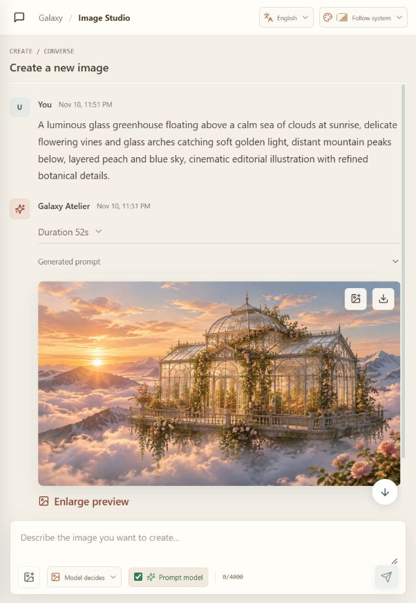

<div align="center">
  

  <h1>Galaxy Atelier</h1>
  <p><strong>将自然语言对话转化为图像的自托管工作室。</strong></p>
  <p>
    <a href="README.md">English</a> ·
    <a href="#项目介绍">项目介绍</a> ·
    <a href="#效果展示">效果展示</a> ·
    <a href="#快速开始">快速开始</a> ·
    <a href="#ubuntu-部署">Ubuntu 部署</a>
  </p>
  <p>
    
    
    
    
  </p>
</div>

Galaxy Atelier 是一款轻量的自托管图像创作 Web 工作区。你可以用对话描述画面，选择是否通过语言模型润色提示词，再将请求发送给自己配置的图像 API。会话、生成结果、用量和管理功能都由你自己的服务器承载。

项目专注于一件事：把用户的创意请求转化为图像。它不是通用型电脑操控 Agent。

## 目录

- [效果展示](#效果展示)
- [项目介绍](#项目介绍)
- [功能特性](#功能特性)
- [图像生成流程](#图像生成流程)
- [系统架构](#系统架构)
- [安全与数据边界](#安全与数据边界)
- [运行要求](#运行要求)
- [快速开始](#快速开始)
- [模型服务配置](#模型服务配置)
- [Ubuntu 部署](#ubuntu-部署)
- [运维与备份](#运维与备份)
- [开发与测试](#开发与测试)
- [项目结构](#项目结构)
- [当前限制](#当前限制)

## 效果展示

以下图片均由 Galaxy Atelier 调用已配置的图像 API 实际生成。画布尺寸由模型决定，应用会记录服务端返回的真实尺寸。

<table>
  <tr>
    <td width="50%" valign="top">
      
      <p align="center"><strong>云海之上的植物温室</strong><br>3344 × 1882 · 生成图像</p>
    </td>
    <td width="50%" valign="top">
      
      <p align="center"><strong>雨夜东京黑胶唱片店</strong><br>2804 × 2244 · 生成图像</p>
    </td>
  </tr>
  <tr>
    <td width="50%" valign="top">
      
      <p align="center"><strong>海岸灯塔丝网印刷海报</strong><br>2048 × 3072 · 模型选择竖版画布</p>
    </td>
    <td width="50%" valign="top">
      
      <p align="center"><strong>图像工作台</strong><br>应用运行时生成结果页面的实际截图</p>
    </td>
  </tr>
</table>

项目自带一份[图像提示词编写规范](AGENT.md)，用于约束语言模型只负责整理提示词。身份验证、服务商调用、文件存储和图像交付仍由服务器控制。

## 项目介绍

Galaxy Atelier 将对话式图像创作界面与一个轻量自托管服务结合起来：

- React 客户端提供账号、会话、提示词输入、图像预览、用量页面和管理界面。
- Node.js 服务验证请求，将应用记录保存在 SQLite，并且只调用管理员配置的语言模型和图像服务。
- 提示词润色模型可以关闭，关闭后即可直接进行文生图。
- 可以上传图片作为视觉参考或编辑目标；在同一会话中继续修改时，会将最近一次成功的图像作为编辑目标。

界面支持中文和英文，默认跟随浏览器语言，并提供多套浅色和深色主题。

## 功能特性

- **对话式图像创作：** 在会话中集中查看创意描述、提示词和生成结果。
- **提示词润色开关：** 查看最终发送给图像模型的提示词，也可跳过润色模型直接生成。
- **参考图编辑：** 选择上传或拖入图片，并指定它是编辑目标还是视觉参考；继续对话时可以基于当前会话最近的成功结果修改。
- **画布选择：** 支持正方形、竖版、横版，或交由模型决定。关闭提示词润色且使用模型决定尺寸时，会采用服务端支持的横向预设。
- **持久化请求队列：** 每个会话最多排队 12 个请求；等待中的任务可以编辑或删除，服务重启后仍会保留。
- **会话管理：** 搜索、重命名、归档、恢复和删除会话。
- **生成文件管理：** 校验生成图像格式与尺寸，并使用模型生成的描述性文件名。
- **用量与运营信息：** 查看个人用量、管理员流量概览、账号用量和可导出的操作日志。
- **工作区管理：** 管理员可以创建、停用和删除账号，并配置兼容 API 的地址、密钥、模型 ID 和用量价格。
- **多语言界面：** 支持中文和英文、自动识别浏览器语言，以及包含跟随系统模式在内的十种主题。

## 图像生成流程

1. 登录管理员创建的账号，然后新建一个图像会话。
2. 输入画面描述；需要时上传参考图片，并选择编辑模式或参考模式。
3. 选择是否启用提示词润色，并设置画布比例或交由模型决定。
4. 启用润色时，配置的语言模型会收到本次请求、适用的会话文本上下文，以及作为多模态输入的上传图片。跟进编辑时，同一会话最近成功生成的图像也会作为编辑目标。
5. 服务器将润色后的请求发送到已配置的图像 API；关闭润色时则直接请求文生图。用户明确上传的参考图仍会发送给图像服务。
6. 生成结果、实际图像尺寸、模型信息、服务商提供的用量数据和任务状态会显示在会话中。生成失败时也会保留模型返回的可用文字反馈。

提示词模型没有隐藏的工具访问能力。应用不会向其提供 Shell、文件系统、浏览器、插件或任意 URL 访问工具。

## 系统架构

```text
浏览器
  └─ React + TypeScript 客户端
       └─ 同源 /api 请求
            └─ Node.js HTTP 服务
                 ├─ SQLite：账号、会话、消息、队列、用量与审计记录
                 ├─ DATA_DIR/images：生成图像和后续编辑素材
                 ├─ 管理员配置的 OpenAI 兼容聊天补全接口
                 └─ 管理员配置的 OpenAI 兼容图像接口
```

前端使用 Vite 构建。后端基于 Node.js 内置的 HTTP 和 SQLite API，无需另行安装数据库服务器或服务商 SDK。生产模式下，Node.js 服务会在同一来源提供前端静态文件和 API。

## 安全与数据边界

- 不开放公开注册。首次启动时由服务端环境变量创建初始管理员，后续账号由管理员创建。
- 密码使用 scrypt 哈希。会话 Cookie 使用 `HttpOnly` 和 `SameSite`；生产环境另外启用 `Secure`。
- 服务商密钥和管理员覆盖的 API 地址使用 `APP_ENCRYPTION_KEY` 通过 AES-256-GCM 加密保存。必须妥善保存并保持该密钥不变，否则现存配置无法解密。API 不会返回已保存的服务商密钥。
- 会话、消息、队列、图像和用量数据都按已登录账号隔离；管理路由仅供管理员访问。
- 上传图片会进行文件特征校验，并限制文件大小与图像尺寸，只发送到所选工作流需要的已配置服务商。队列中的图片在 SQLite 内加密保存，任务消费或删除后清除；审计记录只保留元数据，不包含图像字节。
- 应用文件和数据库均保存在 `DATA_DIR`。提示词模型不具备本机操控能力。
- 附带的 systemd 服务模板使用专用非特权用户运行，将可写路径限制为数据目录，并启用操作系统级加固。

自托管不代表不经过第三方服务：用户提交生成请求后，提示词以及适用的参考图片和会话上下文会发送到管理员配置的模型服务。请了解相应服务商的数据处理条款，并按需限制出站网络。

## 运行要求

- Node.js **24.9 或更新版本**（项目使用内置的 `node:sqlite` 模块）。
- npm（随 Node.js 提供）。
- 进行真实图像生成时，需要兼容的聊天补全 API 和图像生成 API。
- Ubuntu systemd 部署需要 systemd **247 或更新版本**，以支持所附服务单元使用的全部加固指令。

## 快速开始

克隆仓库并安装锁定的依赖：

```sh
git clone https://github.com/ABone16/galaxy-atelier.git
cd galaxy-atelier
npm ci
```

创建环境文件并生成全新的加密密钥：

```sh
cp .env.example .env
openssl rand -hex 32
```

编辑 `.env`：将示例加密密钥替换为生成的 64 位十六进制字符串，设置唯一的初始管理员邮箱和密码，并按需填写服务商 API 根地址。示例服务商地址是占位符，并不可用于实际请求。

启动开发客户端和 API：

```sh
npm run dev
```

在浏览器中打开 `http://127.0.0.1:5173`。Vite 提供客户端页面，API 默认监听 `127.0.0.1:4318`。使用初始管理员账号登录后，在 **Models & keys** 页面配置两个模型服务。项目支持 OpenAI 兼容服务；管理员可设置 API 地址、密钥和模型 ID，也可以从服务商的 `/models` 接口获取可用模型。

也可以本地构建后启动生产服务：

```sh
npm run build
npm start
```

生产模式由 Node.js 服务统一提供构建后的前端和 API。远程访问时请设置 `NODE_ENV=production`，并通过支持 TLS 的反向代理提供服务。

## 模型服务配置

两个模型服务均使用 OpenAI 兼容的请求形式：

| 用途 | 请求 |
| --- | --- |
| 获取模型 | `GET {BASE_URL}/models` |
| 润色提示词 | `POST {BASE_URL}/chat/completions` |
| 生成新图 | `POST {BASE_URL}/images/generations` |
| 依据参考图编辑 | `POST {BASE_URL}/images/edits` |

请在受保护的管理页面中填写准确的服务根地址、密钥和模型 ID。不要把接口路径（例如 `/chat/completions`）也拼到根地址中。具体服务必须实现本项目使用的请求和响应字段。图像生成当前要求响应在 `data[0].b64_json` 中返回 Base64 PNG；应用不会下载任意远程图片 URL。自动获取模型仅展示服务商公开的模型 ID，并不保证列表中的每个模型都支持当前图像接口约定。

图像模型有一项明确的兼容回退：如果 `gpt-image-2.6` 返回 HTTP 404，且不在服务商提供的模型列表中，服务器会在列表包含相应模型 ID 时尝试 `gpt-image-2.5` 或 `gpt-image-2`。生成结果和审计记录会注明实际使用的模型。这不是通用模型切换或重试策略。

环境变量默认值参见 [`.env.example`](.env.example)。默认服务地址明确使用占位域名；管理员覆盖的服务地址会和密钥一起加密保存。

## Ubuntu 部署

请直接在目标 Ubuntu 服务器上构建，不要复制在 Windows 或其他操作系统上安装的 `node_modules`。仓库提供了 systemd 模板 [`deploy/atelier-agent.service`](deploy/atelier-agent.service) 和环境文件模板 [`deploy/atelier-agent.env.example`](deploy/atelier-agent.env.example)。

使用可信的软件源安装 Node.js 24.9 或更新版本，并创建专用服务账号与数据目录：

```sh
sudo useradd --system --home /var/lib/atelier-agent --shell /usr/sbin/nologin atelier-agent
sudo install -d -o atelier-agent -g atelier-agent -m 700 /var/lib/atelier-agent
sudo install -d -m 700 /etc/atelier-agent
sudo install -d -o "$(id -un)" -g "$(id -gn)" -m 755 /opt/atelier-agent
```

将干净的仓库克隆到这个空目录。目录归当前部署用户所有，因此依赖安装和构建不必以 root 身份执行：

```sh
git clone https://github.com/ABone16/galaxy-atelier.git /opt/atelier-agent
cd /opt/atelier-agent
npm ci
npm run typecheck
npm test
npm run build
npm run test:production
```

根据 `deploy/atelier-agent.env.example` 创建 `/etc/atelier-agent/atelier-agent.env`。设置生产环境变量、通过 `openssl rand -hex 32` 生成的新密钥、唯一的初始管理员账号和模型服务地址。然后限制文件访问权限：

```sh
sudo chown root:root /etc/atelier-agent/atelier-agent.env
sudo chmod 600 /etc/atelier-agent/atelier-agent.env
```

安装并验证服务单元：

```sh
sudo install -o root -g root -m 644 deploy/atelier-agent.service /etc/systemd/system/atelier-agent.service
sudo systemd-analyze verify /etc/systemd/system/atelier-agent.service
```

该单元默认假设源码和构建产物位于 `/opt/atelier-agent`、数据保存在 `/var/lib/atelier-agent`，且 Node.js 位于 `/usr/bin/node`。路径不同时请相应调整服务单元。然后启用服务：

```sh
sudo systemctl daemon-reload
sudo systemctl enable --now atelier-agent
sudo systemctl status atelier-agent
sudo journalctl -u atelier-agent -n 100 --no-pager
```

确认初始管理员已能正常登录后，从环境文件中删除 `INITIAL_ADMIN_EMAIL` 和 `INITIAL_ADMIN_PASSWORD`，再重启服务：

```sh
sudo systemctl restart atelier-agent
```

应用默认只监听回环地址 `127.0.0.1:4318`。请将其置于负责 TLS 终止的反向代理之后，不要把应用端口直接暴露到公网。systemd 单元使用 `ProtectProc` 和 `ProcSubset`，因此要求 systemd 247 或更高版本。

## 运维与备份

- 保持 `APP_ENCRYPTION_KEY` 不变，并在数据库之外安全备份该密钥。丢失密钥后无法解密已保存的服务商凭据和 API 地址。
- 备份完整 `DATA_DIR`，包括 `atelier.sqlite`、可能存在的 SQLite WAL 文件和 `images/` 目录。在线备份建议使用 SQLite Backup API；否则先停止服务再复制。
- 严格限制环境文件、数据目录和备份的访问权限；不要发布 `.env`、数据库、日志或私人图像。
- 为图像参考图上传设置合理的 TLS 和反向代理请求体/超时限制。应用允许最多 10 MiB 的参考图片，并为编码后的生成请求预留更大的请求体上限。
- 使用 `systemctl status` 和 `journalctl -u atelier-agent` 检查状态与日志。`/api/health` 仅检查服务进程，不代表模型服务连通性。

## 开发与测试

```sh
npm run typecheck
npm test
npm run build
npm run test:production
```

`npm test` 会运行 Node.js 测试套件。生产冒烟测试会在隔离的临时数据目录中启动生产构建服务，并模拟模型 API 请求，覆盖初始管理员、登录、模型配置、图像生成、图片读取、用量、审计和退出流程，不会连接真实模型服务。发布改动前请运行类型检查、测试、生产构建和冒烟测试。

## 项目结构

```text
src/                         React 客户端、API 类型、多语言和界面样式
server/index.ts              HTTP API、SQLite、身份验证、生成与服务商调用
tests/                       单元测试和安全/集成测试
scripts/                     生产冒烟测试和隔离的服务商模拟器
deploy/                      systemd 与环境文件模板
docs/assets/                 README 宣传图、生成示例和界面截图
AGENT.md                     宿主使用的提示词编写角色与工具边界
.env.example                 本地和生产环境变量模板
```

## 当前限制

- Galaxy Atelier 不附带图像模型、提示词模型或 API 额度。生成真实图片需要自行配置兼容的服务。
- API 兼容并不意味着所有服务可以直接互换：接口路径、认证方式、编辑能力、输出格式和用量字段可能不同，请先确认服务商约定。
- 当前部署方案面向单个 Node.js 进程、本地 SQLite 数据库和文件系统图像存储，不提供横向扩展或对象存储配置。
- 用量费用依据管理员填写的价格和服务商返回的使用情况估算；部分服务商不会返回 Token 或成本数据。
- 服务商条款、限流、模型 ID 和 Linux 软件源由各自维护者控制，可能独立于本项目发生变化。
